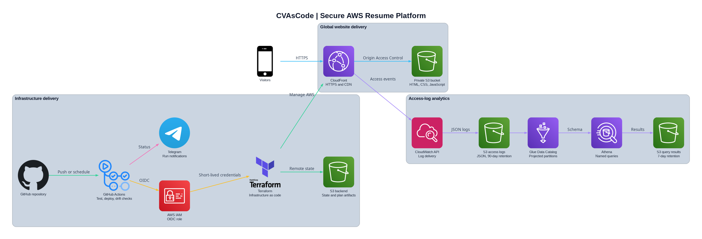

# CVAsCode



We built and deployed a secure static resume website on AWS with Terraform, Amazon S3, and Amazon CloudFront. GitHub Actions tests and deploys the infrastructure through OIDC. CloudFront logs can be queried in Amazon Athena, and scheduled checks detect Terraform drift.

## Tech stack

- Frontend: HTML, CSS, and JavaScript
- Infrastructure as code: Terraform
- AWS: Amazon S3, Amazon CloudFront, Amazon CloudWatch, AWS Glue Data Catalog, Amazon Athena, and AWS IAM
- CI/CD: GitHub Actions with OpenID Connect (OIDC) authentication to AWS
- Code quality and security: TFLint and Trivy
- Tools: Go and AWS SDK for Go
- Notifications: Telegram Bot API

## Local development

### Prerequisites

Install these tools before you start:

- Git
- Terraform `1.16.1`
- AWS CLI v2
- TFLint `0.64.0`
- Trivy `0.70.0`
- `uv` and Python `3.13` or later
- Graphviz for architecture diagrams
- GitHub CLI, if you want to manage repository configuration from a terminal

Use an AWS account and a local AWS role that can create S3 and IAM resources. Do not use the AWS root user. The bootstrap role also needs permission to create the project resources.

### Clone and install

```bash
git clone https://github.com/DanielHemmati/CVAsCode.git
cd CVAsCode
uv sync
```

Generate the architecture header after you change `diagram.py`:

```bash
uv run python diagram.py
```

### Configure the AWS CLI

Configure a named AWS CLI profile with credentials from your AWS account:

```bash
aws configure --profile cvascode
export AWS_PROFILE=cvascode
aws sts get-caller-identity
```

The last command must return the AWS account that will contain the project. Do not store access keys or AWS credentials in this repository.

### Replace project-specific values

This repository contains values for the original AWS account and GitHub repository. Replace them before you create resources:

1. Replace the state bucket name in every `terraform/live/**/backend.tf` file.
2. Update the GitHub OIDC subject and role name in `terraform/live/global/github-oidc/main.tf`.
3. Update the allowed principals in `terraform/live/global/plan-artifacts/main.tf`.
4. Replace the AWS role ARN and plan bucket in `.github/workflows/`.
5. Keep the GitHub environment name as `production`, or update it in Terraform and every workflow.

The current GitHub Actions role uses `AdministratorAccess`. Replace it with a least-privilege policy before you use this project for production workloads.

### Bootstrap Terraform

Terraform uses separate S3 state files for each live stack. Create the state bucket first with local state:

```bash
terraform -chdir=terraform/live/global/s3-backend init -backend=false
terraform -chdir=terraform/live/global/s3-backend plan -out=terraform.tfplan
terraform -chdir=terraform/live/global/s3-backend show terraform.tfplan
terraform -chdir=terraform/live/global/s3-backend apply terraform.tfplan
terraform -chdir=terraform/live/global/s3-backend init -migrate-state
```

Read the saved plan before you apply it. Accept the state migration only after the new bucket name is correct.

Next, bootstrap these stacks in order:

1. `terraform/live/global/github-oidc`
2. `terraform/live/global/plan-artifacts`
3. `terraform/live/prod/static-site`

Run this process for each stack. Replace `<stack>` with one path from the list:

```bash
terraform -chdir=<stack> init -input=false -lockfile=readonly
terraform -chdir=<stack> plan -input=false -lock-timeout=5m -out=terraform.tfplan
terraform -chdir=<stack> show terraform.tfplan
terraform -chdir=<stack> apply -input=false -lock-timeout=5m terraform.tfplan
```

The static-site stack must exist before the CloudFront logging stack can read its remote-state outputs. After this bootstrap, use GitHub Actions for changes to production infrastructure.

### Configure GitHub Actions

Create a GitHub environment named `production`. Protect `main` and require pull-request reviews because a merge to `main` can apply infrastructure changes.

The workflows use OIDC to request short-lived AWS credentials. Do not add AWS access keys as GitHub secrets.

Add these repository secrets if you want Telegram notifications:

```bash
gh auth login
gh secret set TELEGRAM_BOT_TOKEN
gh secret set TELEGRAM_CHAT_ID
```

The workflows have these responsibilities:

- `tf-module.yaml` formats, validates, lints, and scans reusable Terraform modules.
- `tf-live.yaml` checks live stacks on pull requests. On `main`, it creates saved plans, stores them in private S3, and applies the exact plans.
- `deploy-resume.yaml` uploads `resume-page/` to S3 and invalidates the CloudFront cache. Run it manually from `main`.
- `drift-detection.yaml` compares AWS resources with Terraform state every 12 hours.
- `telegram-notifications.yaml` reports workflow results to Telegram.

### Continue development

Create reusable infrastructure in `terraform/modules/`. Add environment values in a focused root under `terraform/live/`. Update one phase from the current document in `docs/`, then run local checks:

```bash
terraform fmt -check -recursive -diff terraform
tflint --config=.tflint.hcl --init
trivy config terraform
```

Open a pull request and wait for both Terraform workflows to pass. Review the change before you merge it into `main`.

## Agent workflow

The agent first creates an implementation plan in the `docs/` directory and divides the work into phases. It completes one phase at a time, then waits for my review and approval before it starts the next phase.

The project uses these agent skills:

- `terraform-skill`: Guides Terraform development, testing, and troubleshooting.
- `simple-english`: Keeps documentation clear and concise.
- `grill-me`: Refines a plan through focused questions.
- `grill-with-docs`: Refines a plan and creates supporting documents.
- `to-spec`: Converts an agreed plan into a specification.
- `to-tickets`: Divides a specification into implementation tasks.
- `implement`: Implements work from a specification or task.
- `code-review`: Reviews changes against project standards and requirements.
- `retro`: Reviews a completed session and identifies workflow improvements.

## Ideas to expand this project

- [ ] Use aws bedrock (nova micro model) to summarize the resume using single prompt
- [ ] Use DynamoDB for visitor counts (not page on page load, base on unique IP at first then make it more advance)
- [ ] SBOM & Supply-Chain Security — Syft, Grype, and artifact integrity
- [ ] Infracost - Terraform cost estimation (not useful for this project b/c we are using serverless services and they are usage base mostly)

The foundation of this project is ready you just have to continue the loops of:

1. Use grill-me so you know what you exactly want
2. Generate a and put it under `docs/` folder
3. Turn the plan into small phases so you can review (I much rather review & i don't have enough token for agent review)
4. See agent first create module and live terraform
5. Then push and `tf-module.yaml`, `tf-live.yaml` will do the job

## Why stop?

Currently I am working on creating k8s platform which start simple (just software workload, dev/staging/prod env) and then expand to have have inference and AI workload as well, which is far more interesting to me than this project.

And I want to finish [iximuiz lab](https://labs.iximiuz.com/) and all of the 100 days challenge from kodekloud.
